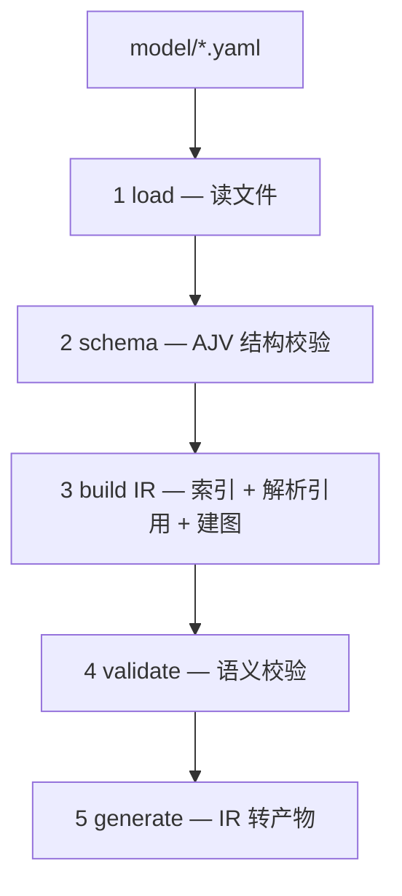
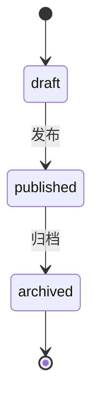

# PolyForge 文档写作规范

这份规范约束 `polyforge/docs/` 下的全部文档。

## 一、事实来源

唯一正确的参考是 **polyforge 的实际代码**。旧文档只作线索。

写任何一节之前，先读对应源码；与旧文档冲突时，以代码为准。

**示例一律用中性、通用的内容**（如 `User`、`Order`、`Article`），**不得使用本项目的真实业务模型**。原因有三：polyforge 独立开源、业务模型不随之开源；具体业务缺乏泛化性；业务概念有专业门槛，外人看不懂。

这条同样适用于：实体名、枚举值、状态机、流程图、任何示例代码。

## 二、术语

| 统一用 | 不用 |
|---|---|
| 模型（Model） | 契约 |
| 模型编译器、polyforge | contract-compiler |
| IR | 中间表示 |
| 产物 | 生成物 |

术语首次出现写「中文（English）」，之后只用中文。

## 三、五类章节

### 概念章

用于：实体、视图、API、枚举。结构：定义 → 在模型中 → 产物 → 陷阱。

实际效果：

---

**实体**是模型里描述一张数据库表的单元。一个实体对应一张表：字段是列，索引是索引。

在模型中：

```yaml
entities:
  User:
    table: users
    fields:
      id:    { type: id, idType: long }
      phone: { type: string, length: 32, unique: true }
```

生成的产物：

| 端 | 产物 |
|---|---|
| 数据库 | `CREATE TABLE users (...)` |
| 后端 | `User.java`（JPA 实体） |
| 前端 | 不生成（实体不暴露给前端） |

陷阱：

❌ 实体名小写开头

```yaml
user:            # 必须 PascalCase
```

✅ 正确

```yaml
User:
```

---

### 操作章

用于：快速开始、配置、CLI。结构：目标 → 前置 → 步骤 → 验证 → 下一步。

实际效果：

---

**目标：** 从零写一个最小模型并生成代码。

**前置：** Node ≥ 18，项目已装 polyforge。

**步骤：**

1. 写一个最小模型 `model/global/enums.yaml`：

   ```yaml
   kind: global
   enums:
     Role:
       values: [admin, user]
   ```

2. 在项目根写 `polyforge.config.mjs`：

   ```js
   export default {
     source: 'model',
     outputs: { frontendTypes: 'src/generated' },
   }
   ```

3. 生成：

   ```bash
   npx polyforge gen
   ```

**验证：** `src/generated/` 出现 `.ts` 文件。

**下一步：** [核心概念](./part1-getting-started/3-core-concepts.md)

---

### 参考章

用于：校验规则、类型映射、CLI 参数。结构：表头 → 含义 → 正反例。

实际效果：

---

#### C18 · 实体恰有一个主键

| 项 | 值 |
|---|---|
| 编号 | C18 |
| 级别 | 错误 |
| 触发 | 实体中 `type: id` 的字段数量 ≠ 1 |
| 所在 | `validate/index.mjs` |

每个实体必须且只能有一个主键。

正例：

```yaml
User:
  fields:
    id: { type: id }
```

反例：

```yaml
User:
  fields:
    id1: { type: id }
    id2: { type: id }   # 两个主键，报错
```

---

### 原理章

用于：架构、IR、生成器机制。结构：问题 → 解法 → 图 → 表 → 取舍。

**图统一用 Mermaid**（GitHub / VitePress 原生渲染），不用 ASCII 图。

实际效果：

---

**问题：** 模型和产物之间，发生了什么？

**解法：** 五层流水线。



| 层 | 文件 | 输入 → 输出 |
|---|---|---|
| load | `parser/load.mjs` | 目录 → 文档数组 |
| schema | `parser/schema-validator.mjs` | 文档 → 错误列表 |
| build IR | `parser/build-ir.mjs` | 文档 → IR |
| validate | `validate/index.mjs` | IR → 错误列表 |
| generate | `generators/**` | IR → 产物 |

**取舍：** 校验分两层——schema 查结构，validate 查语义。结构错就没法建 IR，所以分开。

---

### 扩展章

用于：加生成器、加校验、加语法。结构：场景 → 步骤 → 约束 → 参考。

实际效果：

---

**场景：** 生成一种新产物。

**步骤：**

1. 新建 `generators/xxx/index.mjs`：

   ```js
   export function generateXxx(ir, outDir) { /* ... */ }
   ```

2. 在 `index.mjs` 的 gen 分支接线：

   ```js
   if (out.xxx) generateXxx(ir, out.xxx)
   ```

3. 在 `config.mjs` 解析输出路径。

**约束：** 生成器只读 IR，不读源文件；输出目录由配置给。

**参考：** `generators/java/entity.mjs`（最简实现）。

---

## 四、代码块

标语言：`yaml` `js` `bash` `java` `ts`。

嵌套（代码块里含代码块）时，外层用四个反引号：

````markdown
```yaml
key: value
```
````

## 五、图表

流程图、时序图、状态图统一用 **Mermaid**。

常用类型：

- 流程图：`flowchart TD` / `flowchart LR`
- 时序图：`sequenceDiagram`
- 状态机：`stateDiagram-v2`
- 类图：`classDiagram`

状态机枚举的文档，用 `stateDiagram-v2` 直接画转移图：



## 六、状态标注

未实现：

> ⚠️ **未实现**：以下为设计，当前 polyforge 不支持。

待改进：

> 🔧 **待改进**：见 [校验体系](./part4-design/3-validation.md)。
