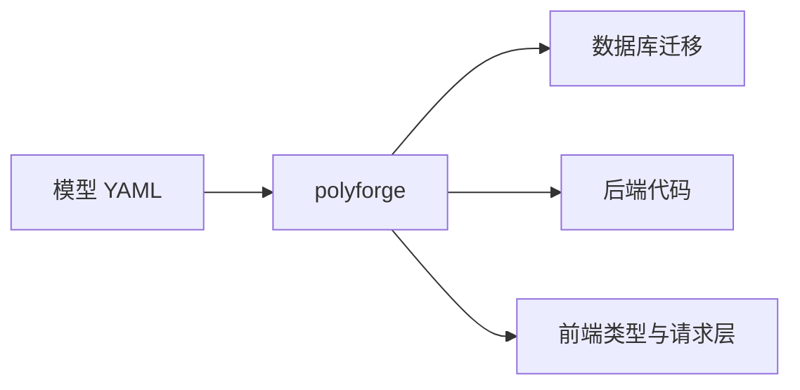

# 1. 它是什么

**PolyForge** 是一个模型编译器。你写一份模型（一组 YAML），它生成数据库、后端、前端三端的代码。

## 它做什么

| 产物 | 内容 |
|---|---|
| 数据库 | 建表 SQL（迁移脚本） |
| 后端 | 实体、DTO、Mapper（DAO）、Assembler、Service 接口、Controller |
| 前端 | 类型定义、请求映射、表单校验规则 |
| OpenAPI | `openapi.json`（可选 target） |

## 它不做什么

PolyForge 是**元层工具**，与具体业务无关：

| 不做 | 原因 |
|---|---|
| 定义业务语义 | 「订单」是什么由你决定，工具不认识业务 |
| 实现业务逻辑 | Service 实现由你手写，工具只生成接口 |
| 规定业务流程 | 状态机的流转由你在模型里定义 |
| 运行时任何事 | 它只在编译期工作，不参与运行 |

**判据**：换一套业务（如图书管理、仓库管理），同一个 polyforge 照样能用——这才是「工具」，而非「某业务的脚手架」。

## 为什么用它

手动维护三端代码，最大的痛是**漂移**：改了数据库字段，忘了改后端实体，又忘了改前端类型。

PolyForge 让**模型成为唯一事实来源**：三端都从模型生成，改一处，三端一致。

## 下一步

[2. 快速开始](./2-quickstart.md)
