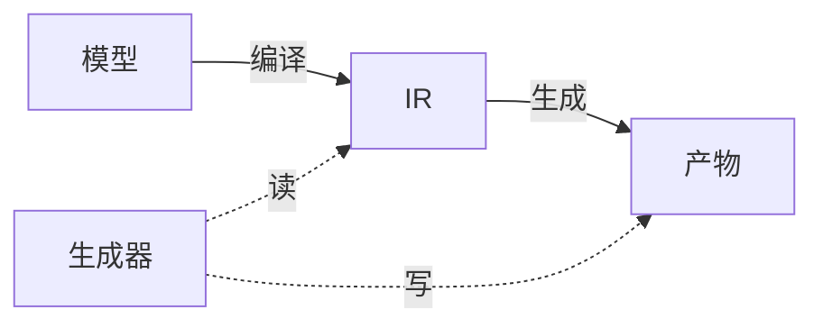
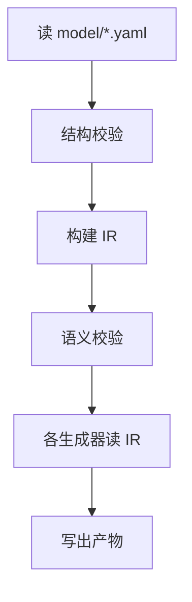

# 3. 核心概念

全书反复出现四个词。先理清它们的关系，后面才不迷路。

## 模型（Model）

你手写的 YAML，存在 `model/` 目录。它是**唯一事实来源**——所有产物都由它派生。

模型分三种文件：

| kind | 放什么 | 例 |
|---|---|---|
| `global` | 全局共享的枚举、视图 | `model/global/enums.yaml` |
| `domain` | 一个业务域的实体、视图、接口 | `model/domains/user.yaml` |
| `permissions` | 权限矩阵 | `model/permissions.yaml` |

## IR（中间表示）

**IR**（Intermediate Representation）是模型**编译后的内存结构**。

polyforge 不直接拿 YAML 生成代码，而是先把它整理成 IR：索引所有定义、解析引用、建依赖图。生成器只读 IR，不读 YAML。

为什么要这一层？

- **引用解析一次**：`type: Role` 到底指哪个枚举，只解析一次，所有生成器共用
- **校验集中**：所有校验都在 IR 上做，不散落在各生成器
- **生成器解耦**：生成器不用关心 YAML 细节，只读规整的 IR

IR 不是文件，是运行时的对象（`Map` + 数组）。用 `polyforge ir` 可以打印它。

## 生成器（Generator）

把 IR 变成某一种产物的模块。一个生成器管一种产物：

| 生成器 | 产物 |
|---|---|
| `java/entity` | 实体、枚举 |
| `java/dto` | 视图 → record |
| `java/controller` | REST 控制器 |
| `frontend/types` | TS 类型 |
| … | … |

生成器是**纯函数**：给它 IR 和一个输出目录，它写出文件。不读源文件，不联网，无副作用。

## 产物（Artifacts）

生成器写出的文件——数据库 SQL、Java 代码、TS 类型。

产物分两类：

| 类型 | 会被 gen 覆盖吗 | 例 |
|---|---|---|
| **全自动** | 会（每次都重建） | 实体、DTO、Controller、类型 |
| **骨架** | 只在首次创建，之后保护 | Service 实现 |

> 手写保护机制详见[产物](../part3-usage/3-outputs.md)。

## 串起来

一次 `polyforge gen` 的完整过程：

## 下一步

进入 [模型规范](../part2-model-spec/1-file-organization.md)，学习怎么写模型。
