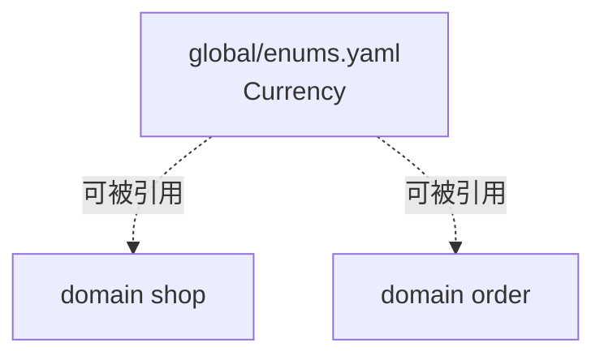

# 1. 文件组织

模型由多个 YAML 文件组成，递归扫描源目录，全部加载。

## 顶层 kind

每个文件的顶层必须有 `kind`，决定它是什么：

| kind | 用途 | 必填字段 |
|---|---|---|
| `domain` | 一个业务域 | `domain` |
| `global` | 全局共享定义 | 无 |
| `permissions` | 权限矩阵 | `roles` |

## 一个文件里能放什么

除 `permissions` 外，文件顶层可含五个段，都是可选的：

```yaml
kind: domain
domain: shop

enums: { ... }
entities: { ... }
views: { ... }
rules: { ... }
api: { ... }
```

| 段 | 内容 | 详见 |
|---|---|---|
| `enums` | 枚举、状态机 | [2. 枚举](./2-enums.md) |
| `entities` | 实体（表） | [3. 实体](./3-entities.md) |
| `views` | 视图（DTO） | [4. 视图](./4-views.md) |
| `rules` | 命名校验规则（手机号/邮箱/身份证等） | [7. 字段语法](./7-field-syntax.md#validate校验器) |
| `api` | 接口 | [5. 接口](./5-apis.md) |

`rules` 段产出的规则通过字段的 `validate: <ruleName>` 引用，最终生成到前端 `formRules.ts`。当前 `global/rules.yaml` 有 6 条规则。

五个段都是 **「名字 → 定义」的映射**，名字跨全局唯一（见下文）。

## domain 与 global

**`domain`** 是业务域，一个文件一个域，`domain` 字段是它的名字：

```yaml
kind: domain
domain: shop
```

**`global`** 放跨域共享的定义（如全项目共用的枚举）：

```yaml
kind: global

enums:
  Currency:
    values: [cny, usd]
```

global 里定义的东西，**任何 domain 文件都能引用**，不必 import。



## 命名规则

| 对象 | 规则 | 例 |
|---|---|---|
| `domain` 名 | 小写字母开头，可含数字和 `-` | `shop`、`award-notice` |
| `enums` / `entities` / `views` 键 | PascalCase | `User`、`OrderItem` |
| `api` 键 | camelCase | `createOrder`、`listUsers` |
| 字段名 | camelCase | `userId`、`createTime` |

**名字跨全局唯一**：枚举、实体、视图、规则的键（name）在整个项目的所有文件里**不能重名**。重名会报 C6。

## 目录组织建议

polyforge 不强制目录结构，但推荐按语义分：

```
model/
├── global/
│   ├── enums.yaml        全项目共用枚举
│   └── views.yaml        全项目共用视图
├── domains/
│   ├── user.yaml         一个域一个文件
│   ├── order.yaml
│   └── ...
└── permissions.yaml
```

目录层级不影响解析——**扫描是递归的，文件放哪都能被找到**。目录只为「人读起来清楚」。

## 下一步

[2. 枚举](./2-enums.md)
