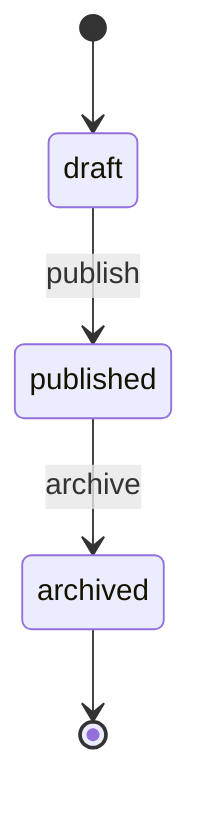

# 2. 枚举

**枚举**是一组固定取值的集合。它对应数据库里的一个字符串列、后端的 Java `enum`、前端的字符串联合类型。

## 在模型中

```yaml
enums:
  Role:
    values: [admin, user, guest]
```

`Role` 是枚举名，`values` 是取值列表。

## 生成的产物

| 端 | 产物 |
|---|---|
| 数据库 | 该枚举作字段时，列类型为 `varchar(32)` |
| 后端 | `Role.java`：常量名 SCREAMING_SNAKE_CASE（`admin` → `ADMIN`，`pendingPayment` → `PENDING_PAYMENT`），带 `@JsonValue`/`@JsonCreator` 做 JSON 桥接 |
| 前端 | `type Role = 'admin' \| 'user' \| 'guest'` |

**三端取值一致**：模型里写 `admin`，三端都用 `admin`（Java 常量名转 SCREAMING_SNAKE_CASE，但 JSON 收发仍是原始 camelCase）。

命名转换规则：camelCase → SCREAMING_SNAKE_CASE，即 `pendingPayment` → `PENDING_PAYMENT`。词边界靠小写→大写切换识别。

## 带标签

给取值配人类可读的中文名：

```yaml
enums:
  Role:
    values: [admin, user]
    labels:
      admin: 管理员
      user: 普通用户
```

`labels` 只用于文档/展示，不影响代码生成。

## 状态机

枚举可以附带**状态机**，声明状态之间允许的流转：

```yaml
enums:
  OrderStatus:
    values: [draft, published, archived]
    state:
      initial: draft
      transitions:
        - { from: draft, to: [published], action: publish, by: [admin] }
        - { from: published, to: [archived], action: archive, by: [admin] }
```

| 字段 | 含义 |
|---|---|
| `initial` | 初始状态，必须是 values 之一 |
| `transitions` | 允许的流转列表 |

每条 transition：

| 字段 | 含义 |
|---|---|
| `from` | 起始状态（一个，或多个） |
| `to` | 目标状态（一个，或多个） |
| `action` | 动作名 |
| `by` | 允许执行的角色（须是 `UserRole` 枚举的取值） |
| `guard` | 守卫条件（字符串描述，供参考） |

用 Mermaid 画出来就是：



> ⚠️ 状态机目前只做**校验**（保证 transition 的 from/to 都在 values 内），
> 不生成运行时状态机代码。流转逻辑仍需在 Service 实现里手写。

## 陷阱

❌ `values` 为空

```yaml
Role:
  values: []        # 报错：枚举至少要有一个值
```

❌ 状态机的 `initial` 不在 values 里

```yaml
OrderStatus:
  values: [draft, published]
  state:
    initial: unknown    # 报错：initial 必须是 values 之一
```

❌ 枚举名小写开头

```yaml
role:               # 必须是 PascalCase
  values: [admin]
```

## 下一步

[3. 实体](./3-entities.md)
