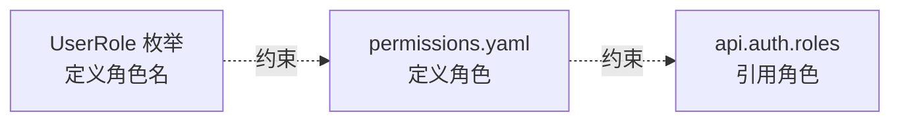

# 6. 权限

**权限**描述「谁（角色）能对什么（资源）做什么（操作）」。它是一份独立的模型文件（`kind: permissions`）。

## 在模型中

```yaml
kind: permissions

resources:
  - name: Article
    operations: [Read, Create, Update, Delete]
  - name: Comment
    operations: [Read, Create]

dataScopes:
  - self
  - all

roles:
  - name: admin
    label: 管理员
    defaultDataScope: all
    permissions:
      - 'Article:*'
      - 'Comment:*'

  - name: editor
    label: 编辑
    defaultDataScope: self
    permissions:
      - 'Article:Read'
      - 'Article:Create'
      - 'Article:Update'
      - 'Comment:Read'
      - 'Comment:Create'
```

## 三个段

### resources

声明系统里有哪些**资源**、每个资源有哪些**操作**。

```yaml
resources:
  - name: Article
    operations: [Read, Create, Update, Delete]
```

### dataScopes

**数据范围**：一个角色能看到多少数据。

| 值 | 含义 |
|---|---|
| `self` | 只看自己的 |
| `rela` | 看与自己相关的 |
| `all` | 看全部 |

### roles

每个角色：

| 字段 | 含义 |
|---|---|
| `name` | 角色名（须与 `UserRole` 枚举一致） |
| `label` | 中文名（仅供展示） |
| `defaultDataScope` | 默认数据范围 |
| `permissions` | 权限清单 |

## permissions 的写法

每条是一个 `资源:操作` 字符串，支持通配：

| 写法 | 含义 |
|---|---|
| `Article:Read` | 对 Article 的 Read 操作 |
| `Article:*` | 对 Article 的所有操作 |
| `*:*` | 所有资源的所有操作（超管） |

## 与 api 的关系

接口的 `auth.roles` 里用的角色，**必须在 permissions 里定义**（报 C25）：

```yaml
# 某个 api
auth: { roles: [editor] }    # editor 必须在 permissions 的 roles 里
```



## 当前能力

> **permissions 只做校验**（C25），**不生成任何代码**。
>
> 具体来说：
> - 校验 `api.auth.roles` 里的角色都在 `permissions.roles` 里定义过（C25）
> - 校验状态机 `transitions.by` 的角色都在 `UserRole` 枚举里（C10）
>
> **不生成**：
> - 后端 `@PreAuthorize` 用的是 `api.auth.roles`（Controller 生成器直接读），**不读 permissions**
> - 前端路由守卫的 `meta.roles` 是**手写**在 `router/index.ts` 里的，不从 permissions 生成
> - `resources` / `dataScopes` / `permissions` 清单目前**未被任何生成器消费**
>
> **待办**（TODO 2.5）：让 permissions 真正驱动生成——后端 `@PreAuthorize`、前端路由守卫权限表。

## 陷阱

❌ 角色名与 `UserRole` 枚举不一致

```yaml
roles:
  - name: editor    # 若 UserRole 里没有 editor，api.auth.roles 引用它会报 C25
```

❌ api 用了未定义的角色

```yaml
# api
auth: { roles: [ghost] }   # 报错：permissions 里没有 ghost 这个角色（C25）
```

## 下一步

[7. 字段语法](./7-field-syntax.md)
