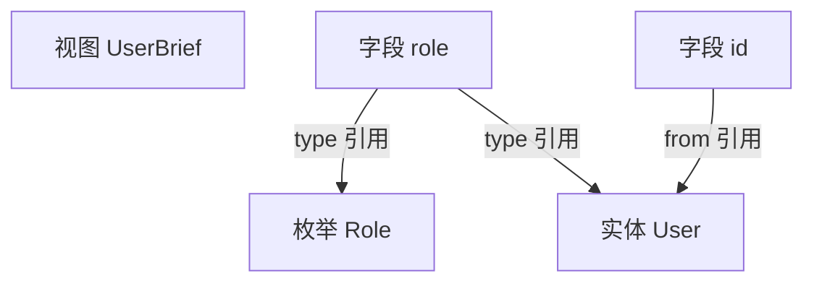

# 9. 引用

模型里的定义不是孤立的——字段会引用别的定义。共有**四种引用**，本章讲清它们的区别。

## 四种引用

| 引用 | 写在哪 | 指向 | 含义 |
|---|---|---|---|
| **type** | 字段的 `type` | 枚举 / 实体 / 视图 | 这个字段是某枚举 / 实体 / 视图的值 |
| **of** | 字段的 `of` | 任意类型 | 数组的元素类型 |
| **from** | 视图字段的 `from` | `实体.字段` | 这个字段的值取自哪 |
| **ref** | 字段的 `ref` | 实体 | 这个字段存的是某实体的 id，类型从目标主键派生 |

## type 引用

字段的 `type` 写一个已定义的名字（枚举或实体）：

```yaml
entities:
  User:
    fields:
      id:   { type: id }
      role: { type: Role }      # 引用枚举 Role

views:
  UserBrief:
    kind: brief
    fields:
      name: { type: string }
```

**能引用什么**：

| 被引用的 | 效果 |
|---|---|
| 枚举 | 该字段是枚举值 |
| 实体 | 该字段是实体（嵌套对象） |
| 视图 | 该字段是另一个视图（嵌套） |

> 引用不存在的名字会报错（C1）。
> 引用方向有限制（C3）：实体只能引枚举/实体，不能引视图。

## of 引用

数组字段用 `of` 声明元素类型：

```yaml
items: { type: array, of: OrderItem }
```

`OrderItem` 可以是枚举、实体或视图。

> 数组必须有 `of`（C15）；`of` 只能配 `array`（C22）。

## from 引用

视图字段声明它**取自哪个实体的哪个字段**：

```yaml
UserBrief:
  kind: brief
  fields:
    id:   { type: string, from: User.id }
    name: { type: string, from: User.name }
```

`from` 的格式固定是 `实体名.字段名`：

| 部分 | 要求 |
|---|---|
| 实体名 | 必须是已定义的**实体**（PascalCase） |
| 字段名 | 必须是该实体里存在的字段（camelCase） |

**from 的作用**：生成的 **Assembler**（`UserBriefAssembler`）会**自动填充**这些字段的取值，不用手写映射。

```java
// 生成的 UserBriefAssembler 里（示意）
public class UserBriefAssembler {
    public static UserBrief from(User user) {
        return new UserBrief(
            String.valueOf(user.getId()),   // from User.id，自动填
            user.getName(),                 // from User.name，自动填
            null                            // 无 from，留 TODO
        );
    }
}
```

> 映射器叫 `Assembler`，不叫 `Mapper`——`Mapper` 是 MyBatis-Plus 的 DAO。

> `from` 指向不存在的实体或字段，会报错（C1）。
> 来源类型与字段类型不兼容（如 long → boolean），会报错（C27）。

## ref 引用

`ref` 声明「这个字段存的是某实体的 id」，类型从目标实体的主键**派生**：

```yaml
Member:
  fields:
    userId: { ref: User, index: true }
    # 不再手写 type: long，类型自动 = User.id 的类型
```

**ref 解决的问题**：同一个 id 在模型里被多处各自声明，类型可能不一致。ref 让 id 类型只有一个来源。

**生成结果**：

| 端 | 类型 |
|---|---|
| PostgreSQL | `bigint`（目标主键是 long）或 `varchar(64)`（string）/ `uuid` |
| Java 实体 | `Long` 或 `String`（按目标主键的 idType） |
| 前端 | `string`（id 一律字符串） |

**ref 是弱边**：`ref: User` 只存 id，不产生对象嵌套，因此**不进 C4 循环检测**。`Department.managerId: { ref: Employee }` 和 `Employee.departmentId: { ref: Department }` 互相引用不报错。

详见 [id 引用设计](../part4-design/id-reference.md)。

## 四种引用的关系



## 陷阱

❌ 引用不存在的名字

```yaml
role: { type: NotDefined }   # 报错：引用不存在（C1）
```

❌ 实体引用视图（方向违规）

```yaml
entities:
  User:
    fields:
      profile: { type: UserProfile }   # 报错：实体不能引视图（C3）
views:
  UserProfile:
    kind: detail
    fields: { ... }
```

❌ from 指向不存在的字段

```yaml
name: { type: string, from: User.noSuchField }   # 报错（C1）
```

## 下一步

模型规范讲完了。进入 [第三部分 · 使用](../part3-usage/1-config.md)。
