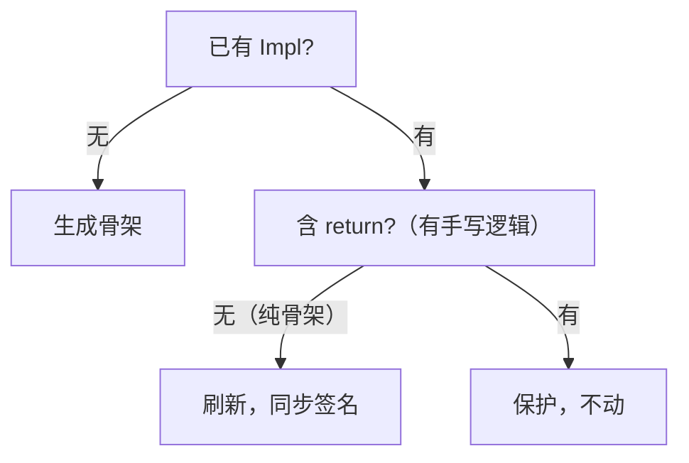

# 3. 产物

gen 会往配置的输出目录写文件。本章说明写了什么、以及「手写代码如何不被覆盖」。

## 按 target 分组

产物按 `--target` 分三组，每组独立：

| target | 产物 |
|---|---|
| `frontend` | TS 类型、请求映射、表单校验规则 |
| `backend` | 实体、DTO、Repository、Mapper、Service 接口、Controller |
| `db` | Flyway 建表 SQL |

`polyforge gen --target=frontend` 只碰前端三个目录，不碰后端和 SQL。

## 产物分类

polyforge 的产物分两类，命运完全不同：

| 类型 | 会被 gen 覆盖吗 | 例 |
|---|---|---|
| **全自动产物** | 会（每次重建） | 实体、DTO、Mapper、Repository、Controller、TS 类型、SQL |
| **手写骨架** | 只首次创建，之后保护 | Service 实现（`*ServiceImpl.java`） |

## 全自动产物

这些文件顶部都带：

```
// AUTO-GENERATED by polyforge. DO NOT EDIT.
```

**不要手动改**——下次 gen 会被覆盖。要改，改模型。

| 产物 | 目录 | 生成器 |
|---|---|---|
| 枚举、实体 | `generated/enums`、`generated/entity` | `java/entity` |
| DTO（视图） | `generated/dto` | `java/dto` |
| 仓库 | `generated/repository` | `java/repository` |
| 映射器 | `generated/mapper` | `java/mapper` |
| Service 接口 | `generated/service` | `java/service` |
| 控制器 | `generated/controller` | `java/controller` |
| 建表 SQL | `outputs.db.flyway` | `java/flyway` |
| TS 类型 | `outputs.frontend.types` | `frontend/types` |
| 请求映射 | `outputs.frontend.requestMap` | `frontend/requestMap` |
| 表单校验规则 | `outputs.frontend.validators` | `frontend/validators` |

## 手写骨架（重点）

Service 的**接口**是全自动的，但**实现**是你手写的。polyforge 用一套规则保护你的代码。

### 首次 gen

输出目录里没有 `XxxServiceImpl.java` → 生成一个骨架，每个方法抛异常：

```java
// 手写实现：纯骨架会被 polyforge 刷新；填入业务逻辑（出现 return）后即受保护。
@Service
public class OrderServiceImpl implements OrderService {

    @Override
    public OrderDetail createOrder(CreateOrderForm form) {
        throw new UnsupportedOperationException("TODO: createOrder");
    }
}
```

### 之后的 gen

polyforge 检查已有的 Impl，分两种：

| 情况 | 判断依据 | 动作 |
|---|---|---|
| **仍是纯骨架** | 方法体全是 `throw TODO`，且全文无 `return` | **刷新**（同步方法签名） |
| **已填业务逻辑** | 出现了 `return` | **保护**，不覆盖 |



### 为什么这么设计

- **纯骨架刷新**：模型改了（比如方法签名变了），骨架还没人填，就跟着更新，不用手动改
- **有逻辑保护**：一旦你写了实现，polyforge 就再也不碰它

### 你要注意的

**接口变了、实现没跟**：如果给某个域**新增了 API**，接口会多一个方法，但已保护的 Impl **不会自动加**——会导致编译错（接口有、实现无）。这是故意的：提醒你手动补实现。

```
接口新增：OrderService.cancelOrder(...)
实现未动：OrderServiceImpl 没有 cancelOrder → 编译错 → 你手动补
```

## 产物目录能否删掉重建

**全自动产物**：可以。整个 `generated/` 目录删掉，重新 gen 就能重建。

**手写骨架**：**不要删**——里面是你写的业务逻辑。删了 gen 只会重新生成空骨架，你的实现就没了。

> 建议用版本控制保护 `*ServiceImpl.java`。

## 下一步

[4. 报错](./4-errors.md)
