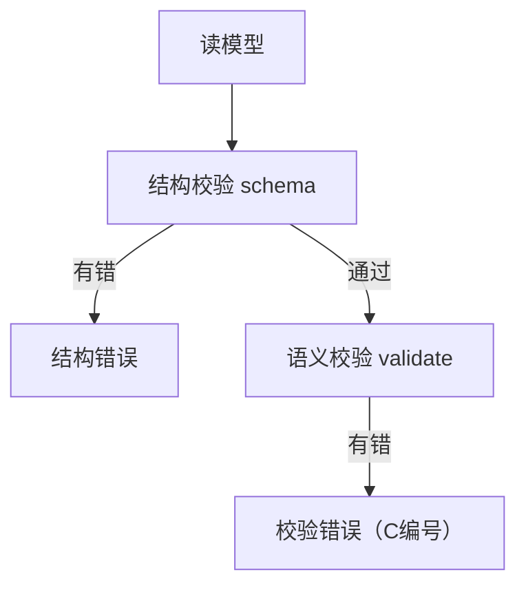

# 4. 报错

polyforge 的报错分两类：**结构错误**和**校验错误**。都带可读的中文说明。

## 两类错误



| 类型 | 何时 | 特征 |
|---|---|---|
| **结构错误** | schema 阶段 | 字段缺失、类型错误、多了不允许的键 |
| **校验错误** | validate 阶段 | 带 `C` 编号，语义问题 |

**任一阶段有错，check 失败、gen 不执行。**

## 配置错误

在**读模型之前**就可能失败，与模型内容无关：

| 报错 | 原因 | 修法 |
|---|---|---|
| `配置文件 ... 缺少 schemaVersion 字段` | 没写 `schemaVersion` | 顶层加 `schemaVersion: '1.0'` |
| `schemaVersion="..." 格式非法` | 写成了 `1`、`1.0.0`、`v1` | 改成带引号的 `'1.0'` |
| `schemaVersion=... 不受当前 polyforge 支持` | major 不匹配 | 升级 polyforge 或迁移配置 |
| `未找到 source 配置` | config 里没写 `source.git`，环境变量也没设 | 按文档补 `source: { git, ref }` |
| `source 不支持字符串（本地路径）形式` | 写了 `source: <路径>` | 改为 git 形式；本地调试用 `POLYFORGE_SOURCE` |
| `--target 只接受: all \| frontend \| backend \| db \| openapi` | 传了非法 target | 用五个合法值之一 |
| `YAMLException: ...` | `polyforge.config.yaml` 语法错 | 检查缩进、冒号后的空格 |
| `Cannot find module 'js-yaml'` | 依赖没装 | `npm i` |

配置错误的特征是**没有 `[polyforge]` 前缀的日志**——它在 `加载模型...` 之前就退出了。

## 结构错误

schema 阶段用 JSON Schema 校验文档结构。典型：

```
[error] /domains/user.yaml 缺少必填字段: fields
[error] /domains/user.yaml.entities.User.fields.id 类型错误（应为 object）
[error] /domains/user.yaml 多出了不允许的字段: fildes
```

特点：**指向具体文件**，说明哪里不合法。

## 校验错误（C 编号）

语义校验的每条规则有编号（C1 ~ C32），输出形如：

```
[error] C18 缺少主键: 实体 User 没有 type:id 字段
[error] C28 路径参数未声明: api getOrder 的路径含 :id，但 pathParams 未声明
[error] C9 角色值非法: api createOrder.auth.roles 含 admin2，不在 UserRole 枚举里
```

**读法**：`C编号` + 说明。C 编号的含义见[校验规则](../part4-design/3-validation.md)。

## 警告

警告不阻断 gen，但提示问题：

```
[warn]  未使用: 枚举 Unused (定义于 domains/user.yaml)
```

## 退出码

| 情况 | 退出码 |
|---|---|
| 有错误 | `1` |
| 只有警告或无问题 | `0` |

CI 靠退出码判断成败：

```bash
polyforge check || exit 1
```

## 常见错误速查

| 报错 | 原因 | 修法 |
|---|---|---|
| `缺少必填字段: fields` | 实体/视图没写 `fields` | 补上 `fields` |
| `C18 缺少主键` | 实体没有 `type: id` 字段 | 加一个主键 |
| `C28 路径参数未声明` | `:id` 没在 `pathParams` 声明 | 补 `pathParams` |
| `C9 角色值非法` | `auth.roles` 用了未定义角色 | 用 `UserRole` 里的值 |
| `C1 引用不存在` | `type`/`from` 指向了没定义的名字 | 检查拼写或补定义 |
| `C6 命名冲突` | 两个地方定义了同名对象 | 改名 |
| `C12 命名规范` | 名字大小写不对 | 按规范改 |

## 下一步

进入 [第四部分 · 原理](../part4-design/1-architecture.md)，了解 polyforge 内部如何工作。
