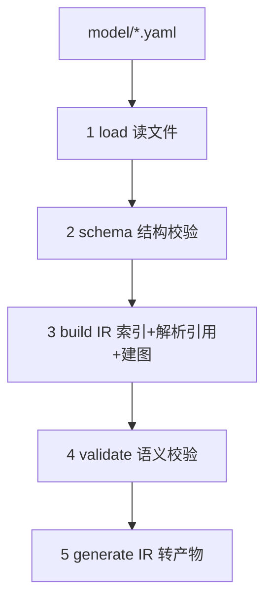
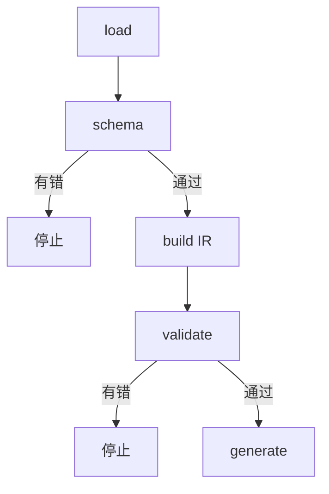
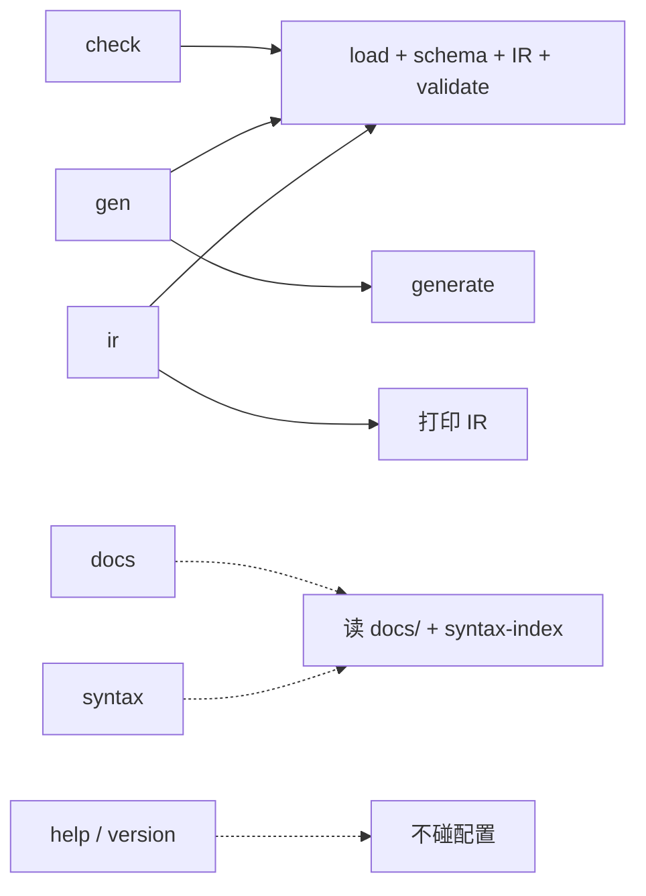

# 1. 架构

**问题**：模型（YAML）和产物（代码）之间，发生了什么？

**解法**：五层流水线，逐层转换。



## 各层职责

| 层 | 文件 | 输入 → 输出 |
|---|---|---|
| load | `parser/load.mjs` | 目录 → 文档数组 |
| schema | `parser/schema-validator.mjs` | 文档 → 错误列表 |
| build IR | `parser/build-ir.mjs` | 文档 → IR |
| validate | `validate/index.mjs` | IR → 错误列表 |
| generate | `generators/**` | IR → 产物 |

入口 `index.mjs` 编排这五层。

## 阶段边界

**关键：错误会阻断后续阶段。**



- schema 有错 → 停止（结构不对，没法建 IR）
- validate 有错 → 停止（语义不对，不生成半成品）

## 为什么这么分层

| 决策 | 原因 |
|---|---|
| load 与 schema 分开 | 读文件是 IO，校验是纯函数，分离后校验可独立测试 |
| schema 与 validate 分开 | schema 查「结构」（用 JSON Schema），validate 查「语义」（引用、类型、环），两者手段不同 |
| build IR 与 validate 分开 | build IR 负责「整理」，validate 负责「挑错」；IR 也是生成器的输入，不只是校验的中间物 |
| 生成器只读 IR | 生成器不碰 YAML、不做校验，只做「IR → 文本」的纯转换 |

## CLI 命令



| 命令 | 跑到哪层 | 用途 |
|---|---|---|
| `check` | validate | 只校验（默认） |
| `gen` | generate | 校验 + 生成（支持 `--target`） |
| `ir` | build IR | 打印中间结构（调试） |
| `docs` | 不跑流水线 | 浏览 `docs/` 文档 |
| `syntax` | 不跑流水线 | DSL 语法速查 |
| `help` / `version` | 不跑流水线 | 帮助 / 版本号 |

前三个（`check` / `gen` / `ir`）走完整五层流水线；后四个在 `loadConfig` 之前就返回，**不读配置、不联网**，任何目录都能跑。

`gen` 支持 `--target=frontend|backend|db|openapi|all`。每个 target 是**独立完整的生成器集合**，`gen --target=all` 只是依次跑完。

检测「契约变了但忘记重新 gen」用 `polyforge gen && git diff --exit-code`，不需要内置 verify 命令（见 [BASELINES.md](../BASELINES.md)）。

## 目录结构

```
polyforge/
├── index.mjs            入口：参数分发 + 编排五层
├── config.mjs           读 polyforge.config.yaml（优先）/ .mjs（fallback）
├── source.mjs           契约源解析：git clone 到系统临时目录的共享缓存
├── cli/
│   ├── args.mjs         参数解析（不碰配置）
│   ├── help.mjs         --help / help <cmd> 文本
│   ├── docs.mjs         polyforge docs 子命令
│   ├── docs-scan.mjs    扫 docs/ 提取 topic
│   ├── syntax.mjs       polyforge syntax 子命令
│   ├── syntax-index.mjs 关键字数据源（与 docs 共用）
│   └── error-format.mjs 错误 → 可读文本（默认两行 / --verbose 展开）
├── parser/
│   ├── load.mjs         层 1：读文件
│   ├── schema-validator.mjs  层 2：结构校验（返回结构化错误对象）
│   └── build-ir.mjs     层 3：构建 IR
├── validate/
│   ├── index.mjs        层 4：语义校验
│   ├── rules.mjs        C1–C33 编号定义（权威表）
│   └── error-hints.mjs  编号 → 修法示例（error-format 的数据源）
├── schemas/
│   ├── contract.schema.json      domain/global 结构
│   └── permissions.schema.json   permissions 结构
└── generators/
    ├── frontend/        层 5：前端产物
    ├── java/            层 5：后端产物
    └── openapi/         层 5：OpenAPI 文档
```

### 契约源在五层之前

`source.mjs` 在 load 之前执行：按 `polyforge.config.yaml` 的 `source.git` 把契约仓库 clone 到系统临时目录（`<tmp>/polyforge-cache-<user>/<repo>-<urlhash>-<ref>/`），跨项目共享；后续按 ref 类型探测远程版本、按需更新。返回实际目录给 load。

**只支持 git 源**——本地路径会导致各消费方版本不一致。唯一例外是环境变量 `POLYFORGE_SOURCE`（仅供 polyforge 自身测试）。

> ⚠️ **待改进**：`schemas/contract.schema.json` 文件名里的「contract」是历史命名，
> 与本书「模型」术语不一致。
>
> `cli/` 目录是 1.1.0 新增的：把「自解释」（`--help` / `docs` / `syntax`）和「错误格式化」从 `index.mjs` 抽出来，保持 `index.mjs` 只做编排。详见 `work-notes/2026-10-21-cli-self-explain-design.md`。

## 下一步

[2. IR](./2-ir.md)
