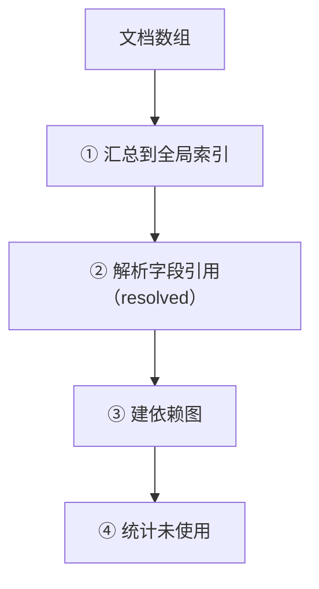

# 2. IR

**IR**（Intermediate Representation，中间表示）是模型编译后的**内存结构**。

它不是文件，是 build IR 层产出的运行时对象。生成器只读 IR，不读 YAML。

## IR 的形状

`buildIR()` 返回一个对象：

```js
{
  enums,       // Map<名字, 枚举定义>
  entities,    // Map<名字, 实体定义>
  views,       // Map<名字, 视图定义>
  rules,       // Map<名字, 规则定义>
  apis,        // 数组（API 有顺序，故用数组）
  graph,       // 依赖图
  allNames,    // Map<名字, {kind, ...}>（所有定义的索引）
  permissions, // { roles, resources }
  errors,      // 构建中发现的错误
  warnings,    // 警告
}
```

用 `polyforge ir` 可以把它打印成 JSON。

## 各部分

### enums / entities / views / rules

都是 `Map`，键是名字，值是定义对象：

```js
enums.get('Role')
// → { values: ['admin', 'user'], kind: 'enum', name: 'Role', domain: 'auth', source: '...' }
```

**每个定义都带上系统字段**（`kind` / `name` / `domain` / `source`），
由 build IR 附加，记录它是什么、来自哪。

### apis

**数组**，不是 Map——因为 API 有顺序（同一路径的多个方法），且名字是 camelCase 不参与去重索引。

```js
apis[0]
// → { name: 'login', method: 'POST', path: '/login', input: 'LoginForm', ... }
```

### graph

依赖图，供校验器查环、查方向：

```js
graph.edges       // [{ from: 'UserBrief', to: 'User' }, ...]
graph.adjacency   // Map<节点, Set<邻居>>
```

边来自字段引用（`type` / `of` / `from`）。

### allNames

所有定义的**全局索引**（枚举 + 实体 + 视图 + 规则 + API），键是名字：

```js
allNames.get('User')
// → { kind: 'entity', name: 'User', ... }
```

用于解析引用：`type: Role` 里的 `Role` 到底指什么，查 `allNames`。

## build IR 做了什么



| 步 | 做什么 |
|---|---|
| ① | 把各文件的 enums/entities/views/rules/api 汇进全局 Map，检测重名（C6） |
| ② | 每个字段的 `type`/`of`/`from` 解析成指向（写入 `resolved` 字段） |
| ③ | 把引用关系建成图（edge） |
| ④ | 统计哪些枚举无人引用（C5 警告） |

### resolved：解析后的引用

字段原始只有 `type: Role`。build IR 解析后，补上 `resolved`：

```js
// 解析前
{ type: 'Role' }

// 解析后
{
  type: 'Role',
  resolved: { kind: 'enum', target: 'Role', values: ['admin', 'user'] }
}
```

**`resolved.kind`** 是下游生成器的关键：

| kind | 含义 |
|---|---|
| `primitive` | 基础类型（string/int/…） |
| `enum` | 引用了一个枚举 |
| `entity` | 引用了一个实体 |
| `view` | 引用了一个视图 |
| `unknown` | 引用不存在（已报 C1） |

生成器靠 `resolved.kind` 决定怎么映射类型，不用重新查名字。

## 为什么要 IR 这一层

| 好处 | 说明 |
|---|---|
| 引用解析一次 | `type: Role` 只解析一次，所有生成器共用结果 |
| 校验集中 | 所有校验在 IR 上做，不散落各生成器 |
| 生成器解耦 | 生成器不碰 YAML、不解析引用，只读规整结构 |
| 可调试 | `polyforge ir` 能看到「polyforge 理解成了什么」 |

## 错误也进 IR

build IR 发现的错误（如引用不存在）会放进 `ir.errors`，最终由 validate 合并上报。

> 这意味着：**IR 可能是「带错」的**——引用没解析成功（`kind: 'unknown'`），
> 但 IR 仍会构建完、返回。真正的「停止」发生在 index.mjs 汇总错误之后。

## 下一步

[3. 校验体系](./3-validation.md)
