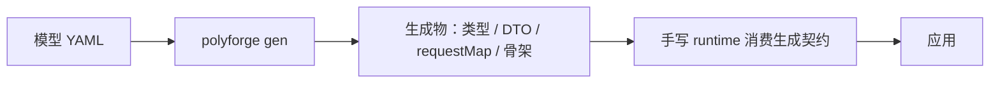

# 6. 运行时

> **状态**：`derived` 语法已实现（C32 校验 + 生成器处理），见 [10. 模型语义](../part2-model-spec/10-model-semantics.md)。
> 本章保留的是「运行时边界」的设计思考：哪些能生成、哪些必须手写。

## 问题

生成器负责「形状」：类型、DTO、SQL、请求映射。但应用里还有一层「行为」：

- HTTP 客户端（token、重试、错误规整）
- 服务端计算字段（显示文本、派生值）
- 运行时装配（把 id 拼成对象、按登录人算权限）

这层现在**纯手写**，与模型脱钩。模型改了，运行时不会感知，容易漂移。

## 三种字段的归属

视图里「不来自数据库列」的字段，分三类：

| 类别 | 例子 | 谁算 | 能否生成 |
|---|---|---|---|
| 服务端计算 | `statusText` | 后端 service | 声明可生成，行为手写 |
| 运行时装配 | `owner: UserBrief` | 后端 service（join） | 声明可生成，行为手写 |
| 权限派生 | `roles: Role[]` | 后端 service（按登录人） | 声明可生成，行为手写 |

共同点：**形状能声明，行为必须手写。**

## 关键概念：derived

字段无 `from` 时，现无法区分「故意服务端算」与「漏写来源」。引入 `derived` 标记显式声明：

```yaml
views:
  OrderBrief:
    kind: brief
    fields:
      id:         { type: string, from: Order.id }
      statusText: { type: string, derived: text }
      owner:      { type: UserBrief, derived: join }
      myRoles:    { type: array, of: Role, derived: permission }
```

`derived` 的取值建议：

| 值 | 含义 |
|---|---|
| `text` | 由枚举/状态派生显示文本 |
| `join` | 运行时关联另一实体/视图 |
| `permission` | 按当前登录人计算 |
| `compute` | 其它服务端计算 |

> 注：`derived` 已在 `contract.schema.json` 的 `FieldDef` 里声明，`validate/index.mjs` 的 C32 检查其语义（取值合法、与 `from` 互斥、`relation` 必须有 `via`）。

## 待补校验：视图字段必须有来源

**当前状态**：未实现。

设想规则（编号待定，C33 候选）：视图字段必须满足其一，否则报错：

1. 有 `from`（列投影）
2. 有 `derived`（服务端计算，显式声明）
3. 有 `default`（默认值）

目的：把「漏写来源」从静默通过变成编译期错误。

> ⚠️ **编号注意**：C31 已被「修饰符位置合法」占用（见 [10. 修饰符适用范围](../part2-model-spec/10-modifier-scope.md)），本规则若实现应占 C33。

## runtime 的定位

runtime **不是生成行为**，而是「消费生成契约的手写库」：



runtime 手写，契约生成。二者边界：

| 属于生成 | 属于 runtime（手写） |
|---|---|
| 类型形状 | HTTP 传输 |
| URL 映射 | token / 错误处理 |
| DTO 骨架 | 业务计算 / join |
| derived 字段占位注释 | derived 字段的真实填充 |

## 能生成的（编译期）

- `derived` 字段的 TS/Java 声明
- 生成的 service 骨架里，为 `derived` 字段留 TODO 占位
- 前端 runtime 的类型契约（requestMap 已是此形态）

## 不能生成的（行为）

- 计算逻辑本身
- 运行时 join 的真实查询
- 权限判定规则

> 模型能表达「形状」，表达不了「行为」。
> polyforge 提供的是「契约一致性」，不是「实现正确性」。

## 已知边界

- `derived` 只声明「服务端填」，**无法验证后端真填了**——与 api 的 `output` 同性质。
- ~~Java DTO 嵌套视图的生成尚未验证~~ → **已验证**（见下）。

### 已验证：视图引用视图

现有契约里有三种嵌套，生成物均编译通过：

| 形式 | 例子 | 生成结果 |
|---|---|---|
| 单视图引用（同域） | `ProjectDetail.costEstimation: CostEstimation` | `CostEstimation costEstimation` |
| 数组视图引用 | `ProjectDetail.workSchedules: List<ProjectWorkSchedule>` | `List<ProjectWorkSchedule> workSchedules` |
| 跨域视图引用 | `BidDetail.contractorOrganization: OrganizationDetail`（bid 域 → auth 域） | `OrganizationDetail contractorOrganization` |

生成器按 `resolved.kind === 'view'` 处理，`List` 类型自动加 `java.util.List` import。

## 落地路线

| 步 | 内容 | 状态 |
|---|---|---|
| 1 | 定义子视图、视图引用视图 | ✅ 已支持（`type` 指向 view） |
| 2 | 验证 gen 产物（尤其 Java DTO 嵌套） | ✅ 已验证（单/数组/跨域三种嵌套均编译通过） |
| 3 | 视图补计算字段 | ✅ 已做（现有契约含 `statusText` 等 derived 字段） |
| 4 | 启用 `derived` + 加 C32 | ✅ 已完成 |
| 5 | 手写类型改为 extends 生成类型 | ⏳ 未做 |
| 6 | 清理 runtime 里的历史兼容层 | ⏳ 未做 |
| 7 | 加「视图字段必须有来源」校验（C33 候选） | ⏳ 未做 |

## 下一步

[第五部分 · 扩展](../part5-extending/1-add-generator.md)
