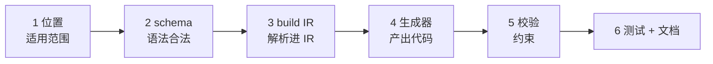

# 3. 加一个语法

**场景**：你想给模型加一个新关键字（如字段的 `encrypted: true`，让后端加密存储）。

新增语法要动**四处**，缺一不可。

## 步骤

### 1. 确定适用范围（位置）

先回答：**这个关键字能写在哪些子模型里？**

模型的字段可能出现在六处：

| 位置 | 含义 |
|---|---|
| `entity.fields` | 数据库列 |
| `view.fields`（kind: form） | 前端 → 后端的入参 |
| `view.fields`（kind: query） | 查询条件 |
| `view.fields`（kind: brief/detail） | 后端 → 前端的出参 |
| `api.query` | URL 查询参数 |
| `api.pathParams` | URL 路径变量 |

**每个新关键字都必须逐一明确：能用 / 不能用。**

例：`derived`（服务端装配字段）

| 位置 | 能用？ | 原因 |
|---|---|---|
| entity | ✗ | 不是数据库列 |
| form | ✗ | 入参方向，非服务端产出 |
| query | ✗ | 查询条件由前端提供 |
| brief/detail | ✓ | 主战场 |
| api.query / pathParams | ✗ | URL 参数由前端提供 |

> 权威矩阵见 [10. 修饰符适用范围](../part2-model-spec/10-modifier-scope.md)。
> ⚠️ **未落实**：位置约束目前无统一校验，`from` 写进 entity、`unique` 写进 view 都能通过。
> 待补一条通用位置校验（C31）。

先定位置，再动 schema。位置没定，后面几步都在猜。

### 2. 改 schema（让语法合法）

`schemas/contract.schema.json` 里，在对应定义（如 `FieldDef`）加属性：

```json
"encrypted": { "type": "boolean" }
```

不加这步，模型里写 `encrypted` 会因 `additionalProperties: false` 报「多了不允许的字段」。

### 3. 改 build IR（解析进 IR）

若新语法影响类型解析或引用，在 `parser/build-ir.mjs` 的 `resolveField` 里处理。多数简单修饰符**不用改**——它会随字段定义原样带进 IR。

### 4. 改生成器（产出效果）

各生成器读 IR 里的新字段，产出对应代码。如 `java/entity` 里：

```js
if (fd.encrypted) lines.push('    @Convert(converter = EncryptConverter.class)')
```

有几个生成器需要，就改几个。

### 5. 加校验（若语法有约束）

如「`encrypted` 只能用在 string」——在 `validate/index.mjs` 加规则（见[加校验](./2-add-validation.md)），占一个新编号。

### 6. 写测试 + 更新文档

- `tests/cases/` 加用例
- [字段语法](../part2-model-spec/7-field-syntax.md)的表里加一行

## 改动清单



| 步 | 文件 | 必做？ |
|---|---|---|
| 1 | （矩阵） | 是（否则位置约束缺失） |
| 2 | `schemas/contract.schema.json` | 是（否则语法非法） |
| 3 | `parser/build-ir.mjs` | 看情况（影响类型才要） |
| 4 | 各 `generators/**` | 是（否则无效果） |
| 5 | `validate/index.mjs` | 看情况（有约束才要） |
| 6 | `tests/` + 文档 | 是 |

## 约束

| 约束 | 原因 |
|---|---|
| **位置先行** | 不先定适用范围，会出现「乱写也能过」 |
| schema 先行 | 语法不合法，后面全白搭 |
| 生成器兼容旧模型 | 新语法可选，旧模型不写它也要能生成 |
| 校验用新编号 | 不与其他规则撞号 |

> 新关键字的「可用位置」要登记进 [修饰符适用范围](../part2-model-spec/10-modifier-scope.md)。
> 该矩阵是位置的唯一权威，新增语法必须同步登记。 

## 慎重：加语法的代价

每加一个关键字，**所有生成器都要考虑它**（哪怕不处理，也要确认无影响）。语法定得越多，工具越难维护。

**先问**：这能不能用现有语法表达？能，就别加。

---

第五部分完。回到 [手册首页](../README.md)。
